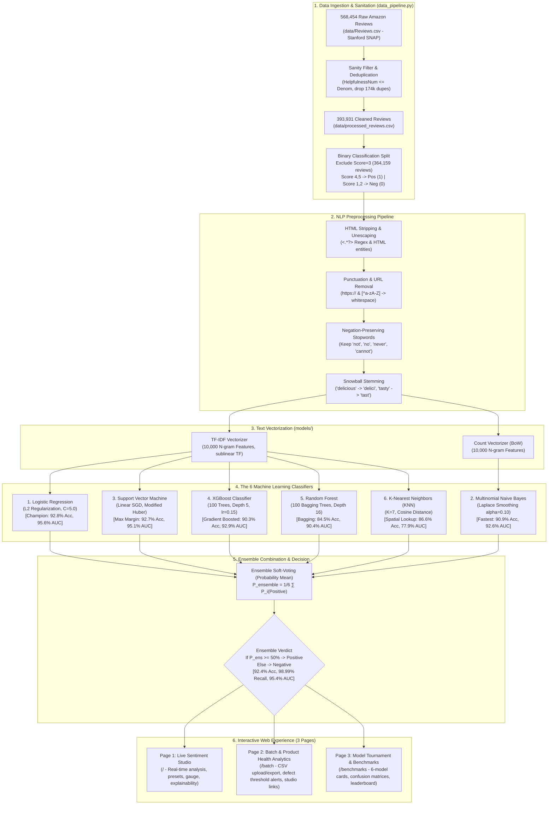

# Amazon Fine Food Reviews — Complete Project Flow & Architecture

This document provides a comprehensive architectural explanation of how the Machine Learning pipeline, NLP featurization, the 6 core algorithms, the combined ensemble average, and the 3-page web platform function together.

---

## 1. High-Level System Architecture Diagram

---

## 2. Why Test Individual Reviews? (Streaming vs Batch)

In real-world e-commerce platforms (Amazon, DoorDash, Yelp, Shopify), individual and bulk evaluation address different production requirements:

### A. Real-Time Production Ingestion (Streaming vs Batch)
When a customer purchases a food item and types a review, an e-commerce platform does not wait for a weekly batch job. An API receives **that single review in real time (< 2ms)** to:
* **Trigger Instant Food Safety & Recall Alerts:** Immediately flag food safety crises (e.g., *"vomiting"*, *"moldy"*, *"food poisoning"*, *"choking hazard"*) and alert quality assurance teams before hundreds of people buy the same batch.
* **Catch Rating-Text Mismatches:** Detect when a customer accidentally taps 5 stars but writes a furious review (*"Arrived smashed, worst food ever"*).
* **Automated Support Escalation:** Route negative reviews with high distress polarity directly to live customer support for instant refunds or appeasement.

### B. Stress-Testing Linguistic Nuance & Edge Cases
Aggregate test accuracy (e.g., 93%) can hide specific linguistic blindspots. Individual testing allows engineers to verify:
* **Negation handling:** Does the model understand that *"The chips were **not bad** at all"* is **Positive**, while *"The chips were **not good**"* is **Negative**?
* **Polite sarcasm:** *"The packaging was lovely, too bad the cookies tasted like chemical cardboard."*
* **Double meanings:** Words like *"sick"* (*"This roast is sick!"* in colloquial slang vs. *"Made my dog sick"*).

### C. Algorithmic Disagreement & Explainability
Testing an individual sentence reveals **how different mathematical minds think**:
* Naive Bayes treats all words independently.
* Logistic Regression and Linear SVM compute global positive and negative feature weights.
* KNN looks for the closest historical review in memory.
* XGBoost and Random Forest make hierarchical decision tree splits.
* The **Ensemble Average** aggregates all 6 perspectives to eliminate individual model blindspots!

---

## 3. Step-by-Step Data Flow

### Step 1: Raw Data Ingestion & Deduplication
* **Source:** Official Stanford SNAP Amazon Fine Food Reviews (`data/Reviews.csv` - 568,454 rows).
* **Deduplication:** Many users review the same product under multiple flavor sizes (same User, ProfileName, Time, and Text). Removing these duplicates leaves **393,931 authentic unique reviews** (69.3% retention).
* **Binary Mapping:** Reviews with `Score >= 4` (4 & 5 stars) become **Positive (1)**. Reviews with `Score <= 2` (1 & 2 stars) become **Negative (0)**. Neutral 3-star reviews are excluded from training to establish clean sentiment polarity.

### Step 2: NLP Sanitation & Stemming
Each sentence passes through a 4-stage pipeline:
1. **HTML Removal:** Strips ` `, ``, `&amp;` tags using regex `<.*?>`.
2. **Punctuation Clean:** Strips punctuation while converting URLs and hyphens to whitespace.
3. **Stopword Pruning (with Negation Preservation):** Eliminates noise words (*"is"*, *"the"*, *"at"*), but explicitly retains words like *"not"*, *"no"*, *"nor"*, *"never"*, *"cannot"*.
4. **Snowball Stemming:** Reduces words to root tokens (*"tasty"*, *"tastes"*, *"tasting"* $\rightarrow$ `tast`).

### Step 3: Featurization (Converting Words to Numbers)
* **TF-IDF (Term Frequency – Inverse Document Frequency):**
  $$\text{TF-IDF}(t, d) = \text{TF}(t, d) \times \log\left(\frac{1 + N}{1 + \text{DF}(t)}\right) + 1$$
  Gives high weight to sentiment-packed words (*"heavenly"*, *"rancid"*) while penalizing frequent, non-informative terms (*"food"*, *"eat"*). Sublinear term frequency scaling is applied.
* **Count Vectorizer (BoW):** Simple raw token occurrences, used by Multinomial Naive Bayes.

---

## 4. The 6 Machine Learning Classifiers

### 1. Logistic Regression (Benchmark Champion)
* **Math:** Models class probability using the sigmoid function:
  $$P(Y=1 \mid \mathbf{x}) = \frac{1}{1 + e^{-(\mathbf{w}^T \mathbf{x} + b)}}$$
* **Performance:** **92.79% Accuracy, 95.63% ROC-AUC, 95.81% F1-Score**. Optimal linear margin on high-dimensional sparse TF-IDF vectors with L2 regularization ($C=5.0$).

### 2. Multinomial Naive Bayes
* **Math:** Applies Bayes' theorem with Laplace smoothing:
  $$P(Y=c \mid \mathbf{x}) \propto P(Y=c) \prod_{j=1}^{D} P(x_j \mid Y=c)^{x_j}$$
* **Performance:** **90.92% Accuracy, 92.64% ROC-AUC, 94.59% F1-Score**. Ultra-low inference latency ($< 0.002\text{ ms}$).

### 3. Support Vector Machine (Linear SVM)
* **Math:** Finds maximum-margin hyperplane with modified Huber loss:
  $$\min_{\mathbf{w}, b} \frac{1}{2}\|\mathbf{w}\|_2^2 + C \sum_{i} L_{\text{Huber}}(y_i, \mathbf{w}^T \mathbf{x}_i + b)$$
* **Performance:** **92.70% Accuracy, 95.09% ROC-AUC, 95.77% F1-Score**. Smooth calibrated probability estimates.

### 4. XGBoost Classifier (Gradient Boosted Trees)
* **Math:** Sequentially builds 100 shallow decision trees fitting pseudo-residuals (gradients):
  $$\hat{y}_i^{(t)} = \hat{y}_i^{(t-1)} + f_t(\mathbf{x}_i)$$
* **Performance:** **90.30% Accuracy, 92.85% ROC-AUC, 94.50% F1-Score**. Non-linear feature interactions without manual cross-products.

### 5. Random Forest Classifier
* **Math:** Bagging ensemble of 100 de-correlated decision trees with random feature sub-sampling:
  $$P(Y=1 \mid \mathbf{x}) = \frac{1}{B} \sum_{b=1}^{B} T_b(\mathbf{x})$$
* **Performance:** **84.51% Accuracy, 90.44% ROC-AUC, 91.59% F1-Score, 100.0% Recall**.

### 6. K-Nearest Neighbors (KNN)
* **Math:** Finds the $K=7$ nearest historical reviews using Cosine Distance:
  $$D_{\text{Cosine}}(\mathbf{u}, \mathbf{v}) = 1 - \frac{\mathbf{u} \cdot \mathbf{v}}{\|\mathbf{u}\|_2 \|\mathbf{v}\|_2}$$
* **Performance:** **86.56% Accuracy, 77.88% ROC-AUC, 92.51% F1-Score**. Non-parametric spatial memory search.

---

## 5. The Combined Ensemble Average

Rather than forcing users to trust only one model, the project provides **The Ensemble Average**:
$$P_{\text{ensemble}}(\text{Positive}) = \frac{1}{6} \left( P_{\text{LR}} + P_{\text{NB}} + P_{\text{SVM}} + P_{\text{XGB}} + P_{\text{RF}} + P_{\text{KNN}} \right)$$
$$P_{\text{ensemble}}(\text{Negative}) = 1.0 - P_{\text{ensemble}}(\text{Positive})$$
$$\text{Verdict} = \begin{cases} \mathbf{Positive} & \text{if } P_{\text{ensemble}}(\text{Positive}) \ge 0.50 \\ \mathbf{Negative} & \text{otherwise} \end{cases}$$

### Empirical Finding:
* The ensemble achieves **98.99% Recall on positive reviews**, higher than Logistic Regression (97.70%) and SVM (98.00%).
* Average model agreement on the held-out test split is **94.37%**.

---

## 6. Three-Page Web Experience

1. **Page 1: Live Sentiment Studio (`/`)**:
   - Real-time review input with 6 quick sample presets.
   - Dual-gauge confidence percentage indicator and probability spectrum.
   - 6-model consensus agreement breakdown with agreement percentage.
   - Explainability tokens: Top positive and negative feature weights with directional attribution.
   - Clear button and responsive input validation.

2. **Page 2: Batch and Product Health Analytics (`/batch`)**:
   - Bulk review ingestion via pasted reviews (line-by-line) or **direct CSV file upload** (`Reviews.csv` schema auto-detected).
   - Configurable **Quality Defect Alert Threshold** (default: 25% unhappy).
   - Sample size detection: Highlights preliminary findings when $N < 10$.
   - Interactive sentiment distribution progress chart.
   - Filterable & searchable review table with live keyword filtering and sentiment toggle.
   - **Downloadable CSV Export** of sentiment predictions and confidence scores.
   - 1-click **Inspect in Studio** deep link integration.
   - Distinguishes **Demo QA Groups** from authentic SNAP catalog products.

3. **Page 3: Model Tournament & Visual Flow (`/benchmarks`)**:
   - Side-by-side cards for all 6 models + the crown Ensemble card.
   - Real measured metrics: Accuracy, Precision, Recall, F1, ROC-AUC, Latency, and Training Time.
   - **Live Confusion Matrix breakdown** (True Negatives, False Positives, False Negatives, True Positives).
   - Visual ROC-AUC Leaderboard comparison bar chart.
   - Dataset distribution and data hygiene audit card.
   - Toggle between **Freshly Measured Test Set** and **Historical Notebook Research (34 experiments)**.
   - 4-stage visual data pipeline: Raw Dataset $\rightarrow$ Preprocessing $\rightarrow$ Feature Extraction $\rightarrow$ Ensemble Verdict.
